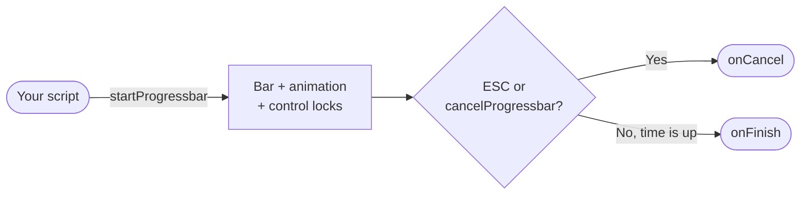

<div align="center">



<br>


**Progress bar in JVL Steel Blue with character animations, callbacks and control locks.**
Works with any framework, and can also draw ox_lib's `lib.progressBar`.

[Features](#-features) · [How it works](#-how-it-works) · [Installation](#-installation) · [API](#-api) · [License](#-license)

</div>

---

## ✨ Features

<table>
<tr>
<td width="50%" valign="top">

### ⏳ Progress with callbacks
`startProgressbar` plays an optional animation and calls `onFinish` or `onCancel` at the end. The player cancels with **ESC**; other scripts with `cancelProgressbar()`.

### 🚫 Control locks
Optional `disable` table: `move`, `car`, `combat`, `mouse`. Without it, `Config.Default.disable` is used (everything allowed by default).

</td>
<td width="50%" valign="top">

### 🎨 JVL Steel Blue
Colors, font, borders and the light line come from `jvl-steel-blue.css`, the same look as every JVL UI. Layout options: width and position (`center`, `top`, `bottom`).

### 🧩 Display mode for ox_lib
`ShowBar` / `HideBar` only draw the bar, so a patched `lib.progressBar` can keep its own logic and show this UI. Standalone: no framework needed.

</td>
</tr>
</table>

## 🔄 How it works



<details>
<summary><b>📁 Project structure</b></summary>

<br>

| Path | Contents |
| --- | --- |
| `fxmanifest.lua` | Resource manifest (no dependencies) |
| `config.lua` | Width, position, default text / duration / control locks |
| `client.lua` | Exports, animation, control locks, ESC cancel, `/testprogress` |
| `index.html` · `jvl-steel-blue.css` | NUI |
| `assets/readme/` | README banner (not loaded in game) |

</details>

## 🚀 Installation

1. Download this repository into your `resources` folder as `jvl_progressbar`.
2. Add it to `server.cfg`:

```cfg
ensure jvl_progressbar
```

3. Test it in game: `/testprogress 5000 Testing the bar`.

## 🧩 API

```lua
-- Simple
exports.jvl_progressbar:startProgressbar(5000, 'Processing...')

-- Animation, callbacks and control locks
exports.jvl_progressbar:startProgressbar(
    5000,                          -- duration (ms)
    'Repairing vehicle...',        -- text
    'mini@repair', 'fixing_a_ped', -- animation dictionary and name (optional)
    function() print('done') end,  -- onFinish (optional)
    function() print('cancelled') end, -- onCancel (optional)
    { move = true, car = true, combat = true } -- disable (optional)
)

exports.jvl_progressbar:cancelProgressbar()          -- runs onCancel
local running = exports.jvl_progressbar:isProgressActive()

-- Display only (no timer, controls or animation), e.g. for ox_lib
exports.jvl_progressbar:ShowBar('Loading...', 3000)
exports.jvl_progressbar:HideBar(false)               -- true = shown as cancelled

-- Event
TriggerEvent('jvl_progressbar:start', 'Loading data...', 3000)
```

| Parameter | Type | Required |
| --- | --- | --- |
| `duration` | number (ms) | ✅ |
| `text` | string | ✅ |
| `animDict`, `animName` | string | ❌ |
| `onFinish`, `onCancel` | function | ❌ |
| `disable` | `{ move, car, combat, mouse }` | ❌ |

```lua
-- config.lua
Config.Style = { width = '400px', position = 'bottom' } -- 'center' | 'top' | 'bottom'
Config.Default = {
    text = 'Processing...',
    duration = 5000,
    disable = { move = false, car = false, combat = false, mouse = false },
}
```

---

## 📄 License

Released under the **MIT License** — free to use, modify and share, keeping the copyright notice. See [`LICENSE`](LICENSE).

© 2025-2026 JVL MediaCode

---

<div align="center">

Made by **[JVL MediaCode](https://jvlmediacode.com)** · Jose M. Valenzuela · Meoqui, Chihuahua, México

<sub><a href="mailto:contacto@jvlmediacode.com">contacto@jvlmediacode.com</a> · <a href="https://discord.gg/m2spgxkPfj">Discord</a></sub>

</div>
